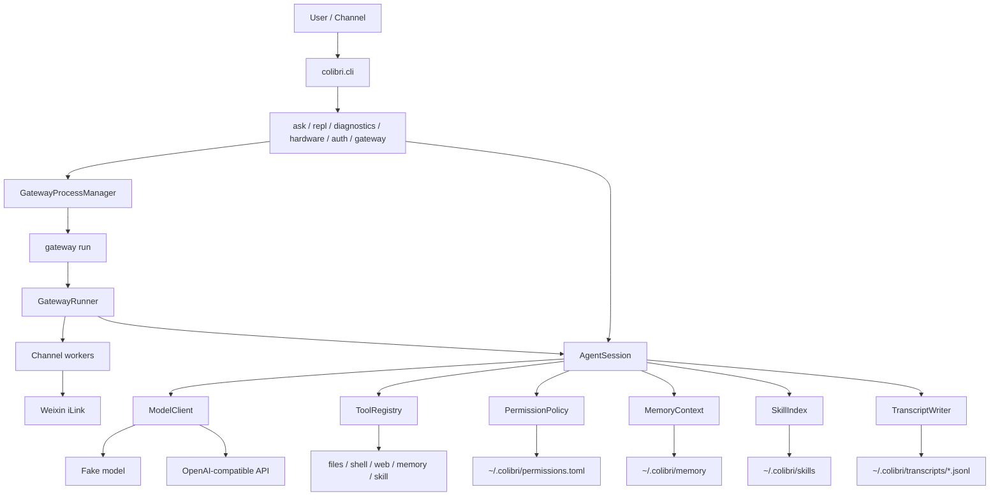

# Colibri

Lightweight Python agent runtime for CardputerZero-class Linux devices.

Colibri is designed to run as a small, headless agent on a Linux card server. It can be used from a local CLI, an SSH session, or a long-running gateway process that connects external chat channels such as Weixin.

[中文文档](README.zh-CN.md)

## Highlights

- Headless runtime: no browser, GUI, system tray, audio device, or TUI framework required.
- Standard-library runtime: third-party packages are only needed for development tests.
- OpenAI-compatible model adapter plus a deterministic fake model for tests.
- Bounded tool loop with dynamic permissions.
- Built-in tools for files, shell, memory, web search, local skills, and opt-in read-only hardware discovery.
- Markdown-backed persistent memory with bounded recall injection.
- Local skills with progressive disclosure.
- Context compacting with model summaries and deterministic fallback.
- JSONL transcripts for CLI and gateway sessions.
- Weixin gateway channel through Tencent iLink.
- Gateway process management: `run`, `start`, `stop`, `restart`, `status`.

## Architecture



## Install And Test

```bash
uv run python -m pytest
uv run python -m colibri.cli ask "hello"
uv run python -m colibri.cli repl
uv run python -m colibri.cli diagnostics
```

The runtime itself is standard-library only. `pytest` is used for development tests.

## Rust Runtime

The shared Rust core in `colibri-rust/` powers CLI, REPL, gateway and the Cardputer worker. It uses a blocking HTTP client and focused crates without a large async runtime.

```bash
cargo test --manifest-path colibri-rust/Cargo.toml
cargo build --release --manifest-path colibri-rust/Cargo.toml
./colibri-rust/target/release/colibri configure
./colibri-rust/target/release/colibri repl
./colibri-rust/target/release/colibri diagnostics
./colibri-rust/target/release/colibri gateway status
```

User configuration is `~/.colibri/config.toml` (or `$COLIBRI_HOME/config.toml`); `--config PATH` selects another file. Missing model configuration produces setup guidance rather than silently selecting a fake model. Run `colibri configure`, or `colibri --config PATH configure`, for step-by-step setup. Secret input is hidden; changes are saved only after confirmation. An explicitly configured `model.provider="fake"` remains available for tests.

The core includes OpenAI-compatible models, memory, transcript recovery and compaction, persistent task evidence, managed background shell jobs, bounded file reads/search/patches, skills, general MCP discovery and calls, search, vision, file/media sending, and Weixin authentication and gateway channels. Runtime access is unrestricted at the application layer; the system prompt asks the agent to confirm dangerous operations. There is no tool grant or permission approval layer. Operating-system and service credentials still apply.

Rust tests cover shared behavior and entry-point workflows. The Python reference suite supplies coverage mappings and deterministic comparisons; new requirements such as model setup and full application access are validated directly in Rust.

## Configuration

If `--config` is omitted, Colibri loads:

```text
~/.colibri/config.toml
```

If the file does not exist, built-in defaults are used. An explicit `--config` path always wins.

Example configs live in:

```text
configs/agent.example.toml
configs/openai.example.toml
configs/glm.example.toml
```

API keys should stay in private config files or environment variables. Do not commit private config files.

## Model Providers

The default provider is deterministic and local:

```bash
uv run python -m colibri.cli ask "hello"
```

For an OpenAI-compatible chat completions endpoint:

```toml
[model]
provider = "openai_compatible"
base_url = "https://your-openai-compatible-api.example/v1"
model = "your-model"
api_key = ""
```

`model.api_key` takes precedence. If it is empty, Colibri reads `COLIBRI_API_KEY`.

## Web Search

The default `web.search` backend remains Baidu. To use Aliyun Bailian's hosted WebSearch MCP instead:

```toml
[web_search]
engine = "aliyun_mcp"
endpoint = "https://dashscope.aliyuncs.com/api/v1/mcps/WebSearch/mcp"
api_key = ""
max_results = 10
timeout_seconds = 10
```

`web_search.api_key` takes precedence. If it is empty, Colibri reads `DASHSCOPE_API_KEY`. This is a hosted Streamable HTTP MCP endpoint: Colibri performs the MCP lifecycle over HTTPS for each search and does not start a local MCP process. The existing `[web_search]` hot reload behavior applies.

## CLI

```bash
uv run python -m colibri.cli ask "hello"
uv run python -m colibri.cli repl
uv run python -m colibri.cli diagnostics
uv run python -m colibri.cli hardware probe
uv run python -m colibri.cli hardware simulate
uv run python -m colibri.cli auth weixin
```

`ask` runs one request and exits. `repl` keeps a multi-turn local session. `diagnostics` prints environment, paths, RSS, and context limits. `hardware probe` lists standard host device nodes without opening them or starting a watcher. `hardware simulate` runs the GPIO/I2C/SPI NDJSON protocol simulator on stdin/stdout for development without a device. `auth weixin` starts iLink QR login and writes the Weixin token to the active config file.

To expose hardware tools to the model, enable both gates and configure an explicit device allowlist:

```toml
[tools]
enabled = ["shell", "files", "web", "image", "memory", "skills", "hardware"]

[hardware]
enabled = true
discovery = "on_demand"
operation_timeout_seconds = 2.0
max_transfer_bytes = 4096

[[hardware.devices]]
name = "controller"
path = "/dev/ttyACM0"
transport = "serial_json"
baud_rate = 115200
capabilities = ["serial", "gpio", "i2c", "spi"]
allow_write = false
```

The model can use only the configured `name` alias, never an arbitrary device path. Tools include `hardware.probe`, `hardware.devices`, `serial.read/write`, `gpio.read/write`, `i2c.scan/read/write`, and `spi.transfer`. GPIO, I2C, and SPI currently use a bounded newline-delimited JSON serial controller protocol; native Linux bus backends remain deferred until the real device interfaces are confirmed.

Side effects require both `allow_write = true` and normal permission approval. Hardware prompts offer `once`, `session-device`, `user-device`, and `deny`; persistent grants are stored in `[hardware].devices` inside `permissions.toml`. Grants cannot override the configured device, capability, timeout, or transfer-size boundaries. Devices are opened per operation and immediately closed, with no resident discovery loop or device handle.

During a long `repl` turn on a TTY, you can type a new line while tools are still running to **steer** the session (skip remaining tools and inject your text). No full-screen TUI — just type and press Enter. Steering is disabled while a permission prompt is active.

## Gateway

Gateway is the process entry for external chat channels.

```bash
uv run python -m colibri.cli gateway run
uv run python -m colibri.cli gateway start
uv run python -m colibri.cli gateway stop
uv run python -m colibri.cli gateway restart
uv run python -m colibri.cli gateway status
```

- `gateway run`: foreground runner for debugging or service managers.
- `gateway start`: background runner; returns immediately.
- `gateway stop`: stops the background gateway.
- `gateway restart`: stop then start.
- `gateway status`: prints process status, PID, RSS when available, config path, state path, and log path.
- `gateway status` also prints `agent_status=healthy|unhealthy`. Process state and Agent health are independent.
- Running Gateway and REPL processes reload `[model]`, `[vision]`, and `[web_search]` from the active config before the next turn. Invalid edits are rejected and the last-known-good runtime remains active. Other sections require a restart.

Background state and logs:

```text
~/.colibri/run/gateway.json
~/.colibri/logs/gateway.log
```

The bare `colibri gateway` command is only a command group and prints usage instead of blocking the terminal.

## Weixin Channel

Configure Weixin in private config:

```toml
[gateway]
enabled_channels = ["weixin"]
max_sessions = 4
session_idle_seconds = 600
max_pending_inbound = 8
max_concurrent_turns = 1

[channels.weixin]
enabled = true
token = "..."
base_url = "https://ilinkai.weixin.qq.com/"
allow_from = []
```

Run QR auth:

```bash
uv run python -m colibri.cli auth weixin
```

Gateway keeps one bounded `AgentSession` per channel user, keyed like `weixin:<sender_id>`. Permission prompts are sent back through Weixin text and accept numeric replies.

While a turn is running tools, a new Weixin message from the same user **steers** the session: remaining tools are skipped and your text is injected. Colibri sends a short Chinese ack immediately (e.g. `已改方向，跳过剩余 N 个工具`). Steering is disabled during permission prompts.

## Built-In Tools

When the model returns tool calls, Colibri can execute:

- `files.list`: list direct children under allowed roots.
- `files.read`: read UTF-8 text files under allowed roots.
- `files.write`: write UTF-8 text files under allowed roots; generated artifacts should use this instead of shell redirection.
- `shell.run`: run commands after permission approval; do not use it to create or edit files.
- `web.search`: search the web through the configured provider.
- `memory.list`: list always-on memory files and topic files.
- `memory.read`: read `SOUL.md`, `USER.md`, `MEMORY.md`, `INDEX.md`, or a topic file.
- `memory.search`: search `INDEX.md` manifest lines; read matching topic files separately.
- `memory.write`: append to or replace a memory file after permission approval.
- `skill.read`: read full `SKILL.md` instructions for a catalog skill by name.
- `skill.run`: run a configured local skill command.

Tool output is capped by `tools.max_result_chars`. Agent turns continue until a final response, an error, or an existing user interruption.

## Permissions

The default permission mode is:

```toml
[tools]
default_permission = "allow_read_confirm_write"
```

Read-only non-shell tools are allowed inside their normal safe boundaries. Shell commands and writes ask for confirmation unless already granted.

Prompt choices:

- `1`: allow once.
- `2`: allow for the current session.
- `3`: shell only, allow the same executable for the current session.
- `4`: allow persistently for this user.
- `5`: shell only, allow the same executable persistently for this user.
- `0`: deny.

User grants are stored in:

```text
~/.colibri/permissions.toml
```

Shell user grants support exact commands and executable grants:

```toml
[shell]
commands = ["pwd", "git status"]
executables = ["cargo", "git"]
```

For compound commands, every unquoted segment must match an exact command or an executable grant. `shell.deny` is checked first.

## Memory

Persistent memory is Markdown-backed:

```text
~/.colibri/memory/
  SOUL.md
  USER.md
  MEMORY.md
  INDEX.md
  topics/
    system-info.md
    colibri-design.md
```

When `memory.enabled = true`, Colibri injects bounded always-on context from `SOUL.md`, `USER.md`, and `MEMORY.md`. Detailed memory lookup is model-driven: the model uses `memory.search` to search `INDEX.md`, then `memory.read` to inspect linked `topics/*.md` files when prior context is needed. Automatic injection is bounded by `memory.max_recall_chars`.

If the memory directory is missing or contains no files, Colibri bootstraps sample `SOUL.md`, `USER.md`, `MEMORY.md`, `INDEX.md`, and `topics/sample.md` files on first memory load. Existing memory files are never overwritten.

Keep `SOUL.md` under 1000 characters, `USER.md` under 1000 characters, and `MEMORY.md` under 2000 characters. If a `memory.write` call leaves any of them over its limit, the tool result asks the model to consolidate it and replace the file.

## Local Skills

Skills live under a single directory:

```text
~/.colibri/skills/<name>/SKILL.md
~/.colibri/skills/<name>/scripts/...  # optional
```

Every `SKILL.md` must start with YAML frontmatter. The frontmatter name must match the directory name:

```markdown
---
name: example
description: Use when the user needs the example workflow.
commands:
  - name: check
    description: Run the local check.
    command: python
    args: [scripts/check.py]
    read_only: true
---

# Example Skill
```

Colibri injects a bounded skill catalog containing each skill's name, description, command names, and path. The model calls `skill.read` when it needs full instructions. When a configured command matches the requested action, the model should use `skill.run` instead of invoking that command through `shell.run`.

Colibri also ships the built-in `create-colibri-skill` guidance skill (not scanned from disk).

## Model Network Recovery

Transient model failures (network/DNS errors, timeouts, HTTP 408/429, and 5xx)
are retried with bounded exponential backoff. The defaults are two retries at
500ms and 1000ms:

```toml
[model]
max_retries = 2
retry_backoff_ms = 500
```

After retries are exhausted, only the current turn fails. REPL returns to the
prompt and gateway sessions remain available for later messages. Channel
adapters remain transport-only and do not implement model retry policy.

## Context And Memory Limits

Important defaults:

```toml
[model]
max_output_tokens = 16384
timeout_seconds = 60
input_context_tokens = 0 # automatic capacity resolution
max_retries = 2
retry_backoff_ms = 500

[session]
transcript = true

[tools]
max_result_chars = 32000

[gateway]
max_sessions = 4
session_idle_seconds = 600
max_pending_inbound = 8
max_concurrent_turns = 1
```

The shared Rust runtime manages compaction using the resolved model window, effective output reservation, and safety headroom. Older complete turns become a bounded summary while recent turns remain verbatim. Enter `/compact` in chat or REPL to compact manually. Original transcript records remain on disk. Optionally set `session.max_context_memory_mib = 10` to add a 10 MiB context-content budget. Omitted or zero leaves this additional budget disabled. If compaction cannot bring content below an explicitly configured budget, the current request returns a capacity error before constructing the model message copy. This content estimate includes history, tool arguments, summary, Memory, skill catalog, and tool definitions. Process RSS, UI, voice models, and tool subprocess memory incur additional costs.

## Transcripts

When `session.transcript = true`, Colibri writes compact JSONL events to:

```text
~/.colibri/transcripts/YYYY-MM-DD.jsonl
```

CLI and gateway sessions both use transcript logging. Gateway transcript payloads include channel metadata such as `channel`, `sender_id`, and `session_key`.

## Console Status And Diagnostics

When `console.status = true`, concise status lines go to `stderr`:

```text
[colibri] ready model=fake-colibri-model
[colibri] thinking
[colibri] tool files.read ok chars=1284
```

Model answers stay on `stdout`.

Diagnostics:

```bash
uv run python -m colibri.cli diagnostics
```

## Systemd

Example service files:

```text
deploy/systemd/colibri-repl.service
deploy/systemd/colibri-gateway.service
```

For gateway boot autostart, use `colibri-gateway.service` with foreground `gateway run` (not `gateway start`).  
The Weixin channel does not listen on a local port; outbound HTTPS plus a configured `channels.weixin.token` is enough under systemd.

Model capacity is resolved from the configured service’s model metadata on first use, with a five-second wait limit. A credential-scoped cache lasts ten minutes and refreshes in the background on later use; successful values persist across restarts. Discovered limits stay in the capability cache and request snapshots, separate from user configuration and App settings. Missing metadata falls back to the bundled catalog or a conservative 48,000-token window. Custom deployments can optionally set `model.input_context_tokens` as an override. Diagnostics reads cached capacity without a network request.

### Runtime context and model-history recovery

Memory and skill-catalog changes append bounded runtime-context snapshots at model-request boundaries. Unchanged context reuses the existing snapshot. Snapshot positions are retained alongside chat messages so later requests preserve the previous prefix. Snapshot bytes participate in context accounting.

Agent recovery restores recorded tool calls, results, original user-message timestamps, summaries, and runtime-context positions. It reads a bounded transcript tail and keeps complete recent turns. Missing tool results after interruption are marked as execution unknown for verification before retrying. Earlier logs retain the information they recorded. App display history continues to show conversation text.
